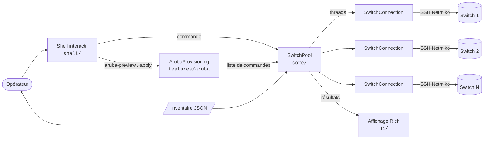
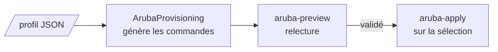

# MultiSwitch

**Un shell Python pour piloter plusieurs switches en parallèle : connexion, commandes, scripts et provisioning Aruba depuis un seul terminal.**


Configurer dix switches un par un, c'est dix sessions SSH et dix fois les mêmes erreurs de frappe. MultiSwitch ouvre toutes les sessions en même temps, envoie la même commande (ou un script entier) à une sélection d'équipements et affiche les résultats côte à côte.

---

## Fonctionnalités

| | |
|---|---|
| **Exécution parallèle** | Les commandes partent sur tous les switches sélectionnés en même temps (`ThreadPoolExecutor`). |
| **Inventaire JSON** | Hôtes, identifiants, type d'équipement, alias et tags dans un fichier versionnable. |
| **Sélection par alias / tag** | `select all`, `select sw1`, `tag sw2 coeur`… pour cibler un groupe d'équipements. |
| **Scripts** | `script fichier.txt` rejoue une liste de commandes sur toute la sélection. |
| **Provisioning Aruba** | Un profil JSON (hostname, VLANs, ports access/trunk, DNS, NTP, SNMP, comptes, bannière) est converti en commandes, prévisualisé puis appliqué. |
| **Lab sans matériel** | `docker-compose.lab.yml` lance des « switches » SSH virtuels pour tester sans équipement réel. |

---

## Architecture



Le cœur (`SwitchPool`) ne connaît ni le shell ni Aruba : une nouvelle fonctionnalité s'ajoute dans `features/` sans toucher au reste. Détails module par module dans [docs/ARCHITECTURE.md](docs/ARCHITECTURE.md).

### Déroulé d'une commande

```mermaid
sequenceDiagram
    participant O as Opérateur
    participant S as Shell
    participant P as SwitchPool
    participant W as Switches (N)
    O->>S: show vlan
    S->>P: exécuter sur la sélection
    par en parallèle
        P->>W: SSH switch 1
        P->>W: SSH switch 2
        P->>W: SSH switch N
    end
    W-->>P: sorties
    P-->>S: résultats groupés
    S-->>O: tableau Rich par switch
```



---

## Installation

```bash
git clone https://github.com/LOIC-only-one/MultiSwitch.git
cd MultiSwitch
python -m venv .venv
source .venv/bin/activate        # Windows : .\.venv\Scripts\Activate.ps1
pip install -r requirements.txt
```

## Utilisation

```bash
python main.py                              # inventaire par défaut
python main.py --inventory switches.lab.json
```

### Commandes du shell

| Commande | Rôle |
|---|---|
| `list` / `ls` | Liste l'inventaire et l'état des connexions |
| `add`, `remove` | Ajoute / retire un équipement |
| `connect`, `disconnect` | Ouvre / ferme les sessions SSH (`connect all`) |
| `select`, `deselect` | Choisit les équipements ciblés |
| `alias`, `tag`, `untag` | Nomme et regroupe les équipements |
| `ping` | Vérifie que les sessions SSH sont vivantes |
| `conf cmd1; cmd2` | Envoie des commandes de configuration (séparées par `;`) |
| *toute autre ligne* | Envoyée telle quelle à tous les switches sélectionnés (`show vlan`…) |
| `script <fichier>` | Rejoue un fichier de commandes |
| `save`, `load` | Sauvegarde / recharge l'inventaire |
| `aruba-preview <profil.json>` | Affiche les commandes générées depuis un profil Aruba |
| `aruba-apply <profil.json>` | Applique le profil sur la sélection |
| `help`, `clear`, `exit` | |

---

## Tester sans matériel

```bash
docker compose -f docker-compose.lab.yml up -d
python main.py --inventory switches.lab.json
```

Puis dans le shell :

```text
connect all
select all
script lab-commands.txt
```

> Les identifiants de `switches.lab.json` ne servent qu'au lab Docker local.

## Provisioning Aruba

Le profil [aruba-profile.example.json](aruba-profile.example.json) décrit la configuration cible. Le flux :



Documentation du profil : [docs/ARUBA_PROFILE.md](docs/ARUBA_PROFILE.md).

---

## Structure

```text
MultiSwitch/
├─ main.py                     point d'entrée
├─ src/multiswitch/
│  ├─ app.py                   arguments + lancement du shell
│  ├─ config/                  constantes
│  ├─ core/switch_pool.py      exécution parallèle
│  ├─ models/                  SwitchConfig, SwitchConnection
│  ├─ shell/                   boucle interactive, autocomplétion
│  ├─ ui/                      affichage Rich
│  └─ features/aruba/          provisioning Aruba
├─ docker-compose.lab.yml      lab de switches virtuels
└─ docs/                       architecture, profil Aruba, contribution
```

## Contribuer

Les règles du projet et la marche à suivre pour ajouter une fonctionnalité sont dans [docs/CONTRIBUTING.md](docs/CONTRIBUTING.md).

---

Projet de [Loïc Maurer](https://github.com/LOIC-only-one) · Réseau & automatisation
